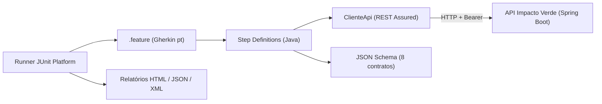

# Documentação de Entrega: Testes Automatizados (Impacto Verde ESG)

> Conteúdo organizado em **seções/slides** para você colar no Word/Google Docs (e exportar para PDF) ou em PowerPoint/Google Slides.
> Cada seção traz o texto pronto. Os blocos **📸 PRINT** indicam exatamente o que capturar.
> *Sugestão de estrutura de slides: 1 slide por seção numerada; as tabelas de cenários podem ser divididas em 2 slides.*

---

## Slide 1: Capa

**Testes Automatizados de API com BDD: Impacto Verde ESG**
*O teste que separa o lixo do código*

- Disciplina: Testes Automatizados
- Aluno(a): `<seu nome>` | RA: `<seu RA>` | Turma: `<sua turma>`
- Stack: Java 21 · Spring Boot · Cucumber · JUnit Platform · REST Assured · JSON Schema · GitHub Actions · Docker

---

## Slide 2: Introdução e tema ESG

O **Impacto Verde** conecta dois públicos: famílias que descartam corretamente resíduos domésticos perigosos em troca de **créditos alimentares**, e PMEs que usam um diagnóstico ESG para comprovar seu impacto.

| Pilar | Onde aparece na API | O que os testes garantem |
|---|---|---|
| **E**nvironmental (Ambiental) | `/coletas` | Resíduos perigosos registrados com tipo, peso e pontos corretos |
| **S**ocial | `/creditos` | Pontos viram alimentos; saldo nunca fica negativo; resgate não passa do saldo |
| **G**overnança | Segurança, `/esg/indicadores` | Autenticação, separação de funções (RBAC), rastreabilidade, só dado auditado conta |

**Por que testar é ESG?** Um bug de crédito em dobro é uma **fraude social**; um indicador inflado é **greenwashing**; um endpoint aberto é **falha de governança**. Qualidade de software é parte da responsabilidade corporativa.

> **Nota de transparência (inclua no trabalho):** o código da aplicação das atividades anteriores não estava disponível durante o desenvolvimento. A API alvo (`api-exemplo/`) foi criada de forma coerente com o documento "Atividade MongoDB: Impacto Verde ESG". A suíte é independente da implementação e pode ser apontada para a API real (ver README, seção 10).

---

## Slide 3: Arquitetura da solução



- **Projeto de testes separado** da API (black-box).
- **Independência:** cada cenário usa uma família com nome único (`familia-qa-xxxxxxxx`) e o hook `@After` apaga as coletas criadas.
- **Configuração:** URL e tokens por variável de ambiente / `-D` / `teste.properties`.

---

## Slide 4: Escolha da stack

| Ferramenta | Função | Justificativa |
|---|---|---|
| Cucumber 8.0.4 | BDD | Cenários legíveis, em português, servem de critério de aceite |
| JUnit Platform 6.1.3 | Executor | Integra com Maven/CI sem plugin extra |
| REST Assured 6.3.0 | Cliente/asserções HTTP | DSL madura, controle de timeout |
| json-schema-validator 6.3.0 | Teste de contrato | Valida tipos, `required`, `enum`, `additionalProperties` |
| AssertJ 3.27.7 | Asserções | Falhas explicam o que aconteceu |
| PicoContainer | Injeção | Estado isolado por cenário |

---

## Slide 5: Visão geral dos testes

| Métrica | Valor |
|---|---|
| Arquivos `.feature` | 4 |
| Cenários escritos (incluindo *Esquemas do Cenário*) | **40** |
| Execuções (cada linha de *Exemplos* conta) | **68** |
| Passos executados | 541 |
| Endpoints cobertos | **11 de 11 (100%)** |
| Schemas JSON | 8 |
| Resultado | **68 passando, 0 falhas, 0 erros, 0 ignorados** |

---

## Seção 6: Cenários Gherkin (descrição detalhada)

Legenda: **P** = positivo · **N** = negativo. Em todos, o **Contexto** (Background) garante *API disponível* e, quando indicado, *autenticação como operador*.

### 6.1 `01-seguranca-e-saude.feature`: Segurança e disponibilidade (Governança)

**Contexto:** a API do Impacto Verde está disponível.

| # | Cenário | Tipo | Objetivo | Pré-condições | Passos principais | Resultado esperado |
|---|---|---|---|---|---|---|
| 1.1 | Health check público responde sem credenciais | P | Provar que a API acorda e que `/saude` é público | Sem token | `GET /api/v1/saude` | 200; `status = UP`; schema `saude` |
| 1.2 | **Esquema:** acesso sem credenciais é barrado com 401 (×10 rotas) | N | Garantir que **todo** endpoint protegido exige crachá | Sem token | Para cada `método + rota` da tabela de Exemplos | 401; cabeçalho `WWW-Authenticate: Bearer`; schema `erro`; sem vazamento de detalhes internos |
| 1.3 | Token inválido também é barrado | N | Impedir acesso com token forjado | Token inválido | `GET /coletas` | 401; mensagem *"Credenciais ausentes ou inválidas"* |
| 1.4 | Operador não pode apagar registros | N | **Separação de funções** (RBAC) | Perfil operador | `DELETE /coletas/{id}` | 403; mensagem *"Perfil sem permissão..."* |
| 1.5 | Método HTTP não suportado | N | Erro padronizado para método incorreto | Operador | `PATCH /coletas` | 405; schema `erro`; sem stack trace |
| 1.6 | Rota inexistente | N | Erro padronizado para rota desconhecida | Operador | `GET /rota-que-nao-existe` | 404; schema `erro` |

### 6.2 `02-coletas.feature`: Gestão de coletas (Ambiental + Rastreabilidade)

**Contexto:** API disponível + autenticado como **operador**.

| # | Cenário | Tipo | Objetivo | Pré-condições | Passos principais | Resultado esperado |
|---|---|---|---|---|---|---|
| 2.1 | Registrar coleta válida nasce pendente e com pontos | P `@esg` | Criar coleta e calcular pontos | Corpo válido (12 pilhas, 0,4 kg) | `POST /coletas` | 201; `Location`; schema `coleta`; `status=PENDENTE`; `pontosGerados=40`; `confirmadaEm=null` |
| 2.2 | **Esquema:** dados inválidos na criação (×10) | N | Validar campos obrigatórios e limites | Corpo válido alterado por linha | `POST /coletas` | 400; schema `erro`; `detalhes` cita o campo e a mensagem exata |
| 2.3 | Tipo de resíduo desconhecido | N | Rejeitar lixo comum (enum) | Tipo `LIXO_COMUM` | `POST /coletas` | 400; sem vazamento de detalhes |
| 2.4 | JSON malformado | N | Robustez do parser | n/a | `POST` com corpo quebrado | 400; schema `erro`; sem stack trace |
| 2.5 | Listar filtrando pela família | P | Filtro por `familia` | 1 coleta criada | `GET /coletas?familia=...` | 200; schema `lista-coletas`; 1 item; id presente |
| 2.6 | **Esquema:** filtrar por status (×2) | P | Separar pendente de confirmada | Coleta confirmada | `GET /coletas?status=CONFIRMADA / PENDENTE` | 200; 1 e 0 elementos |
| 2.7 | Listar família sem registros | P | Lista vazia ≠ erro | Família nova | `GET /coletas?familia=...` | 200; lista vazia |
| 2.8 | Filtro de status inválido | N | Validar parâmetro | n/a | `GET /coletas?status=INVENTADO` | 400; schema `erro` |
| 2.9 | Consultar coleta existente | P | Buscar por id | Coleta criada | `GET /coletas/{id}` | 200; schema `coleta`; campos conferem |
| 2.10 | Consultar coleta inexistente | N | Recurso inexistente | n/a | `GET /coletas/<uuid inexistente>` | 404; *"Coleta não encontrada"* |
| 2.11 | Identificador fora do formato UUID | N | Validar path param | n/a | `GET /coletas/isto-nao-e-um-uuid` | 400 |
| 2.12 | Corrigir coleta pendente recalcula pontos | P | Atualização (PUT) | Coleta pendente | `PUT /coletas/{id}` (20 un., 0,5 kg) | 200; `pontosGerados=50`; ponto atualizado |
| 2.13 | Atualização com peso inválido | N | Validação no PUT | Coleta pendente | `PUT` com `pesoKg=0` | 400; `detalhes` cita `pesoKg` |
| 2.14 | Atualizar coleta inexistente | N | 404 no PUT | n/a | `PUT /coletas/<inexistente>` | 404 |
| 2.15 | Confirmar registra momento e gera créditos | P `@esg` `@rastreabilidade` | Confirmar e gerar crédito | Coleta pendente | `PATCH /coletas/{id}/confirmacao`, depois `GET /creditos/{familia}/saldo` | 200; `CONFIRMADA`; `confirmadaEm` preenchido; saldo = 40 |
| 2.16 | Confirmar duas vezes | N `@esg` | **Evitar crédito em dobro** | Coleta já confirmada | `PATCH` novamente | 409; saldo continua 40 |
| 2.17 | Coleta confirmada é imutável | N `@esg` | **Rastreabilidade**: registro auditado não muda | Coleta confirmada | `PUT` | 409; mensagem de rastreabilidade |
| 2.18 | Confirmar coleta inexistente | N | 404 no PATCH | n/a | `PATCH /coletas/<inexistente>/confirmacao` | 404 |
| 2.19 | Admin remove (204 → 404) | P | Exclusão com ciclo completo | Perfil admin; coleta criada | `DELETE`, depois `GET` | 204 sem corpo; depois 404 |
| 2.20 | Remover coleta inexistente | N | 404 no DELETE | Admin | `DELETE /coletas/<inexistente>` | 404 |
| 2.21 | Operador não remove (403) e a coleta permanece | N | RBAC + integridade | Operador; coleta criada | `DELETE`, depois `GET` | 403; depois 200 |

### 6.3 `03-creditos-alimentares.feature`: Créditos alimentares (Social)

**Contexto:** API disponível + autenticado como operador.

| # | Cenário | Tipo | Objetivo | Pré-condições | Passos principais | Resultado esperado |
|---|---|---|---|---|---|---|
| 3.1 | Saldo reflete coletas confirmadas | P `@esg` `@social` | Consultar saldo | Família com 100 pontos | `GET /creditos/{familia}/saldo` | 200; schema `saldo`; `saldoPontos=100` |
| 3.2 | Saldo de família sem lançamentos | N | Recurso inexistente | Família nova | `GET .../saldo` | 404; *"Família sem lançamentos"* |
| 3.3 | Extrato aponta a coleta de origem | P `@esg` `@rastreabilidade` | Rastrear origem do crédito | Família com 100 pontos | `GET .../extrato` | 200; schema `extrato`; tipo `GERADO`; origem `COLETA:{id}` |
| 3.4 | Extrato de família sem lançamentos | P | Lista vazia | Família nova | `GET .../extrato` | 200; lista vazia |
| 3.5 | Troca de pontos por cesta básica | P `@esg` `@social` `@inclusao` | Resgate de alimentos | Família com 100 pontos | `POST /creditos/resgates` (40 pts) | 201; schema `lancamento`; `valorPontos=-40`; `saldoApos=60`; saldo consultado = 60 |
| 3.6 | Resgate maior que o saldo | N `@esg` | Impedir saldo negativo | Família com 100 pontos | `POST` resgate de 101 | 422; *"Saldo insuficiente..."*; saldo segue 100 |
| 3.7 | **Esquema:** resgate com dados inválidos (×5) | N | Validar payload | Corpo válido alterado | `POST /creditos/resgates` | 400; `detalhes` cita campo e mensagem exata |
| 3.8 | Resgatar sem histórico | N `@esg` | Família sem pontos | Família nova | `POST` resgate de 10 | 422 |

### 6.4 `04-indicadores-esg.feature`: Indicadores ESG (Governança e comprovação de impacto)

**Contexto:** API disponível + autenticado como operador. Os indicadores são globais, então os testes comparam **antes × depois (delta)** para continuarem repetíveis.

| # | Cenário | Tipo | Objetivo | Pré-condições | Passos principais | Resultado esperado |
|---|---|---|---|---|---|---|
| 4.1 | Consultar indicadores respeita o contrato | P `@esg` | Contrato do consolidado | n/a | `GET /esg/indicadores` | 200; schema `indicadores`; tipos corretos |
| 4.2 | Coleta confirmada entra nos indicadores | P `@esg` `@ambiental` `@rastreabilidade` | Impacto mensurável | Fotografia dos indicadores; coleta confirmada | `GET /esg/indicadores` | Δ total=1, confirmadas=1, peso=0,4 kg, pontos=40, famílias=1 |
| 4.3 | Coleta pendente não infla o impacto | P `@esg` `@governanca` `@conformidade` | **Evitar greenwashing** | Fotografia; coleta **pendente** | `GET /esg/indicadores` | Δ total=1 e pendentes=1; peso, pontos e confirmadas **inalterados** |
| 4.4 | Resgate aparece como pontos resgatados | P `@esg` `@social` `@inclusao` | Impacto social | Família com 100 pts; fotografia; resgate de 30 | `GET /esg/indicadores` | Δ `pontosResgatados=30`; `pontosDistribuidos` inalterado |
| 4.5 | **Esquema:** pontos proporcionais ao peso (×6 tipos) | P `@esg` `@ambiental` `@eficiencia` | Regra de cálculo por resíduo | Corpo por tipo e peso | `POST /coletas` | 201; schema `coleta`; pontos conforme tabela |

**Cobertura de ESG:** rastreabilidade (2.15, 2.17, 3.3, 4.2), conformidade/governança (1.x, 4.3), inclusão social (3.5, 4.4) e eficiência de recursos (4.5).

---

## Seção 7: Testes de API: o que é validado em cada resposta

Cada endpoint passa por **três camadas**:

1. **Status code:** 200, 201, 204, 400, 401, 403, 404, 405, 409 e 422, conforme o caso.
2. **Corpo JSON:** valores, tipos e campos relevantes (`jsonPath`), incluindo mensagens exatas de validação por campo.
3. **Contrato (JSON Schema):** `required`, `type`, `enum`, limites (`minimum`, `maxLength`...), `format` e `additionalProperties: false`.

### Tabela de cobertura

| Endpoint | Sucesso | Erros testados | Schema | Cenários |
|---|---|---|---|---|
| `GET /saude` | 200 | n/a | `saude` | 1.1 |
| `POST /coletas` | 201 | 400, 401, 405 | `coleta`, `erro` | 1.2, 1.5, 2.1, 2.2, 2.3, 2.4, 4.5 |
| `GET /coletas` | 200 | 400, 401 | `lista-coletas`, `erro` | 1.2, 1.3, 2.5, 2.6, 2.7, 2.8 |
| `GET /coletas/{id}` | 200 | 400, 401, 404 | `coleta`, `erro` | 1.2, 2.9, 2.10, 2.11 |
| `PUT /coletas/{id}` | 200 | 400, 401, 404, 409 | `coleta`, `erro` | 1.2, 2.12, 2.13, 2.14, 2.17 |
| `PATCH /coletas/{id}/confirmacao` | 200 | 401, 404, 409 | `coleta`, `erro` | 1.2, 2.15, 2.16, 2.18 |
| `DELETE /coletas/{id}` | 204 | 401, 403, 404 | `erro` | 1.2, 1.4, 2.19, 2.20, 2.21 |
| `GET /creditos/{familia}/saldo` | 200 | 401, 404 | `saldo`, `erro` | 1.2, 3.1, 3.2 |
| `GET /creditos/{familia}/extrato` | 200 | 401 | `extrato`, `lancamento` | 1.2, 3.3, 3.4 |
| `POST /creditos/resgates` | 201 | 400, 401, 422 | `lancamento`, `erro` | 1.2, 3.5, 3.6, 3.7, 3.8 |
| `GET /esg/indicadores` | 200 | 401 | `indicadores` | 1.2, 4.1, 4.2, 4.3, 4.4 |

### Schemas (`src/test/resources/schemas`)

| Arquivo | Valida |
|---|---|
| `coleta.schema.json` | Uma coleta (id UUID, enums de tipo/status, limites, `confirmadaEm` nulo ou data) |
| `lista-coletas.schema.json` | Lista de coletas (`$ref` para `coleta`) |
| `saldo.schema.json` | Saldo (`familia`, `saldoPontos` ≥ 0) |
| `lancamento.schema.json` | Lançamento do extrato (resgate tem `valorPontos` negativo) |
| `extrato.schema.json` | Lista de lançamentos |
| `indicadores.schema.json` | Indicadores consolidados e quebra por tipo de resíduo |
| `saude.schema.json` | Health check |
| `erro.schema.json` | **Erro padronizado** (reutilizado em todos os cenários negativos) |

**Prova de que o contrato funciona:** removi de propósito o valor `CONFIRMADA` do `enum` do schema de coleta e a suíte falhou (2 testes). Depois restaurei o schema. *(Pode citar isso como evidência de teste do teste.)*

**Independência e repetibilidade:** massa de dados única por cenário, limpeza no `@After`, indicadores comparados por delta, e API deixada com 0 coletas residuais ao fim.

---

## Seção 8: Configuração do ambiente e execução

### 8.1 Pré-requisitos
JDK 21 · Maven 3.9+ · (opcional) Docker + login em `registry.redhat.io` · `openssl` e `curl`.

### 8.2 Configuração
```bash
./scripts/configurar-ambiente.sh      # gera .env com tokens aleatórios (não vai pro Git)
```
Variáveis: `API_BASE_URL`, `API_TOKEN_OPERADOR`, `API_TOKEN_ADMIN`.

### 8.3 Execução local
```bash
./scripts/executar-local.sh                          # tudo
./scripts/executar-local.sh "@negativo"              # por tag
```

### 8.4 Execução via Docker
```bash
docker login registry.redhat.io
./scripts/executar-docker.sh
```
Imagens Red Hat, usuário não-root, capacidades removidas, sistema de arquivos somente leitura, nenhuma porta publicada.

### 8.5 Pipeline (GitHub Actions)
Arquivo `.github/workflows/testes-api.yml`: checkout → JDK 21 → tokens aleatórios mascarados → build da API → sobe a API e espera o `/saude` → executa o Cucumber → publica resumo e artefato `relatorios-cucumber` (HTML + JSON + XML).

---

## Seção 9: Evidências de execução (o que você deve capturar)

> Eu não consigo gerar prints reais. Siga as instruções abaixo, **na ordem**, e cole cada imagem com a legenda sugerida.

### 📸 PRINT 1: Configuração do ambiente
- **Comando:** `java -version && mvn -v && ls -la .env` (depois do `./scripts/configurar-ambiente.sh`).
- **Capturar:** terminal mostrando JDK 21, Maven e o `.env` criado com permissão `-rw-------`. **⚠️ Não mostre o conteúdo do `.env`** (tokens).
- **Legenda:** *"Figura 1. Ambiente com JDK 21 e Maven; .env gerado localmente com tokens aleatórios (fora do versionamento)."*

### 📸 PRINT 2: Estrutura do projeto
- **Como:** na IDE (ou `tree -L 4 testes/src`), expanda `features/`, `schemas/`, `steps/`, `executor/`.
- **Legenda:** *"Figura 2. Estrutura do projeto de testes: features, step definitions, schemas e runner."*

### 📸 PRINT 3: Arquivo `.feature` em português
- **Como:** abra `02-coletas.feature` mostrando `# language: pt`, `Contexto`, tags e um `Esquema do Cenário` com `Exemplos`.
- **Legenda:** *"Figura 3. Cenários em Gherkin (pt-BR) com Background, Scenario Outline e tags."*

### 📸 PRINT 4: Um schema JSON
- **Como:** abra `coleta.schema.json` mostrando `required`, `enum` e `additionalProperties: false`.
- **Legenda:** *"Figura 4. Schema JSON usado no teste de contrato da coleta."*

### 📸 PRINT 5: API no ar
- **Comando:** com a API rodando, `curl -s http://127.0.0.1:8080/api/v1/saude`.
- **Capturar:** resposta `{"servico":"impacto-verde-api-exemplo","status":"UP"}`.
- **Legenda:** *"Figura 5. Health check da API respondendo UP."*

### 📸 PRINT 6: Execução no terminal
- **Comando:** `./scripts/executar-local.sh`
- **Capturar:** a mensagem `[QA-ESG] API no ar...`, os passos coloridos do Cucumber e, **no final**, `Tests run: 68, Failures: 0, Errors: 0, Skipped: 0` + `BUILD SUCCESS`. Pode ser necessário 2 prints (início e fim).
- **Legenda:** *"Figura 6. Execução local: 68 cenários, 0 falhas, BUILD SUCCESS."*

### 📸 PRINT 7: Relatório HTML (todos passando)
- **Como:** abra `testes/target/cucumber-reports/cucumber.html` no navegador.
- **Capturar:** (a) tela inicial com o resumo **todos verdes**; (b) opcional: um cenário expandido mostrando as linhas de evidência `POST /api/v1/coletas -> HTTP 201` e `Contrato validado contra schemas/coleta.schema.json`.
- **Legenda:** *"Figura 7. Relatório HTML do Cucumber com todos os cenários aprovados."*

### 📸 PRINT 8: Arquivos de relatório gerados
- **Comando:** `ls -la testes/target/cucumber-reports`
- **Capturar:** `cucumber.html`, `cucumber.json`, `cucumber.xml`.
- **Legenda:** *"Figura 8. Relatórios HTML, JSON e XML gerados pela execução."*

### 📸 PRINT 9: Execução por tag
- **Comando:** `./scripts/executar-local.sh "@esg and @positivo"`
- **Legenda:** *"Figura 9. Execução filtrada por tags (@esg e @positivo)."*

### 📸 PRINT 10: Execução via Docker *(se conseguir usar Docker)*
- **Comando:** `./scripts/executar-docker.sh`
- **Capturar:** build das imagens e resultado final dos testes, mais `ls relatorios/`.
- **Legenda:** *"Figura 10. Execução reproduzível em contêineres."*

### 📸 PRINT 11: Pipeline no GitHub Actions
- **Como:** suba o projeto para o GitHub (conteúdo da pasta na raiz) → aba **Actions** → abra a execução verde.
- **Capturar:** (a) lista de passos todos com ✔; (b) rodapé com a seção **Artifacts → `relatorios-cucumber`**; (c) o resumo "Resultado dos testes de API".
- **Legenda:** *"Figura 11. Pipeline executando a suíte e publicando os relatórios como artefato."*

### 📸 PRINT 12: Relatório baixado do pipeline
- **Como:** baixe o artefato, descompacte e abra `cucumber.html`.
- **Legenda:** *"Figura 12. Relatório HTML obtido do artefato do pipeline."*

### 📸 PRINT 13 (bônus): Teste do contrato
- **Como:** em `coleta.schema.json`, tire `"CONFIRMADA"` do `enum`, rode `mvn -f testes/pom.xml test` e capture a falha; depois desfaça a alteração (`git checkout` ou Ctrl+Z).
- **Legenda:** *"Figura 13. Alteração proposital do schema derruba o teste de contrato, o que prova que a validação é real."*

---

## Seção 10: Conclusão

- A suíte valida **11 de 11 endpoints** com status code, corpo JSON e contrato.
- Os cenários cobrem caminhos felizes **e** negativos (validação, inexistência, autenticação, autorização e regras de negócio).
- Os testes de **ESG** garantem rastreabilidade, conformidade, inclusão social e eficiência (sem greenwashing nem crédito em dobro).
- A execução é simples (`./scripts/executar-local.sh`), reproduzível (Docker) e automatizada (GitHub Actions) com **evidências em HTML/JSON/XML**.

**Aprendizados:** BDD melhora a comunicação com o negócio; contrato (JSON Schema) pega mudanças silenciosas; testes independentes e repetíveis valem ouro; e um bug a menos é uma pilha a mais no ponto de coleta. ♻️

---

## Seção 11: Lembretes acadêmicos (antes de enviar)

- ✅ **Confira o arquivo certo antes do upload.** Não dá para reenviar depois que a atividade fechar ou for corrigida.
- ⏰ **Não deixe para os últimos minutos.** Internet cai, ZIP corrompe, e o prazo não negocia.
- 📥 **Entregue apenas pela plataforma.**
- 🚫 **Não compartilhe a resolução** em grupos de WhatsApp, Discord ou Microsoft Teams: isso pode caracterizar plágio e **anular a atividade**.
- 🔎 Você tem **até 15 dias após a publicação da nota** para solicitar **revisão**.

---

## Checklist final de ações suas

- [ ] Preencher nome/RA/turma na capa
- [ ] Capturar os prints 1 a 12 (13 é bônus)
- [ ] Subir o projeto para o GitHub e rodar o pipeline (print 11 e 12)
- [ ] Exportar este documento para PDF/PPT
- [ ] Conferir se o `.zip` não contém `.env` nem `target/`
- [ ] Enviar **somente** pela plataforma
